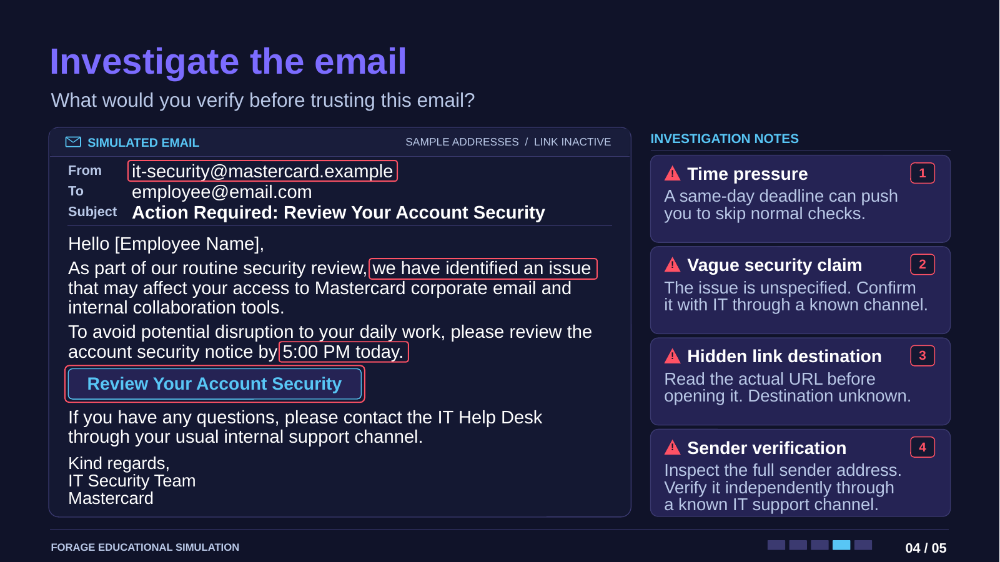

# Phishing Awareness & Risk Assessment

### Interactive Cybersecurity Awareness Training | Mastercard Forage Job Simulation

An independent cybersecurity project focused on analysing simulated phishing campaign results, identifying employee security risks, and designing interactive security awareness training for HR and Marketing teams.

## Project Overview

This project was developed as part of the **Mastercard Cybersecurity Job Simulation on Forage**.

The objective was to analyse a simulated phishing campaign, identify the departments most susceptible to social engineering, and develop targeted security awareness training.

### Project Deliverables

- Phishing campaign data analysis
- HR and Marketing risk assessment
- Five-slide cybersecurity awareness presentation
- Interactive phishing email investigation
- Security awareness and risk mitigation recommendations

---

## 1. Phishing Campaign Analysis

The simulated phishing campaign identified **HR and Marketing** as the two departments with the highest phishing success rates.

### Key Findings

| Metric | HR | Marketing | Overall Average |
|---|---:|---:|---:|
| Email Open Rate | 100% | 65% | 66% |
| Email Click-Through Rate | 85% | 40% | 28% |
| Phishing Success Rate | 75% | 38% | 18% |

**Important:** Phishing success refers to employees who clicked a simulated phishing link and entered personal information. All rates are calculated relative to the number of email recipients.

*Data source: Simulated phishing campaign results provided in the Forage exercise.*

### Risk Assessment

**HR — High Risk**

- 100% of employees opened the simulated phishing email.
- 85% clicked the phishing link.
- 75% entered personal information.
- The results indicate a significant need for improved verification practices and phishing awareness.

**Marketing — High Risk**

- 65% of employees opened the email.
- 40% clicked the phishing link.
- 38% entered personal information.
- The results highlight vulnerabilities to persuasive phishing messages and insufficient verification before sharing information.

### Key Insight

High email engagement should be accompanied by strong security awareness.

Employees need to recognise that a professional-looking message is not necessarily trustworthy.

---

## 2. Security Awareness Training

I designed a five-slide presentation to help HR and Marketing employees understand phishing attacks and respond more effectively.

### Presentation Structure

1. **Looks Legit. Think Again.** — Introduction to phishing awareness.
2. **What Did Our Simulation Reveal?** — Analysis of campaign results.
3. **How Does Phishing Trick Us?** — Common social engineering tactics.
4. **Can You Spot the Phish?** — Interactive email investigation.
5. **Stop. Verify. Report.** — Practical security recommendations.

### Presentation Preview

**Campaign Results**

**Interactive Email Investigation**

### Download Presentation

[View or Download the PowerPoint Presentation](phishing-awareness.pptx)

---

## 3. Interactive Phishing Investigation

### Can You Spot the Phish?

An interactive training exercise designed to help employees investigate suspicious emails.

Participants can examine a simulated phishing email and progressively reveal potential warning signs.

### Investigation Topics

- Unusual urgency and time pressure
- Vague account security claims
- Hidden hyperlink destinations
- Sender identity verification
- Social engineering and authority cues

The exercise emphasises that professional language, official-looking signatures, and familiar terminology are not sufficient evidence of authenticity.

### Try the Interactive Training

[Launch Interactive Phishing Investigation](https://YOUR-USERNAME.github.io/phishing-awareness-training/)

---

## 4. Security Recommendations

The awareness training promotes three essential security behaviours:

### STOP

Think carefully before interacting with unexpected links, attachments, or requests for sensitive information.

### VERIFY

Check the sender's actual email address and inspect link destinations. Verify requests through trusted, independently established communication channels.

### REPORT

Report suspicious communications to the organisation's approved IT Security or incident-reporting channel.

If sensitive information has already been submitted, report the incident immediately and follow the organisation's security response procedures.

---

## 5. Skills Demonstrated

| Skill | Application |
|---|---|
| Cybersecurity Risk Assessment | Analysing simulated phishing campaign results |
| Security Awareness | Designing targeted employee training |
| Social Engineering Analysis | Identifying persuasion and deception tactics |
| Data Analysis | Comparing department-level performance metrics |
| Risk Mitigation | Developing practical security recommendations |
| Technical Communication | Presenting security risks to non-technical audiences |
| Interactive Training Design | Building an educational phishing investigation |

---

## Key Takeaway

**STOP. VERIFY. REPORT.**

Security starts with a second look.

---

## Disclaimer

This is an independent educational project developed in connection with the Mastercard Cybersecurity Job Simulation on Forage.

All campaign data is simulated and does not represent real Mastercard employee activity or security incidents.

This repository is not affiliated with or officially endorsed by Mastercard. The work does not constitute professional employment or an internship with Mastercard.
